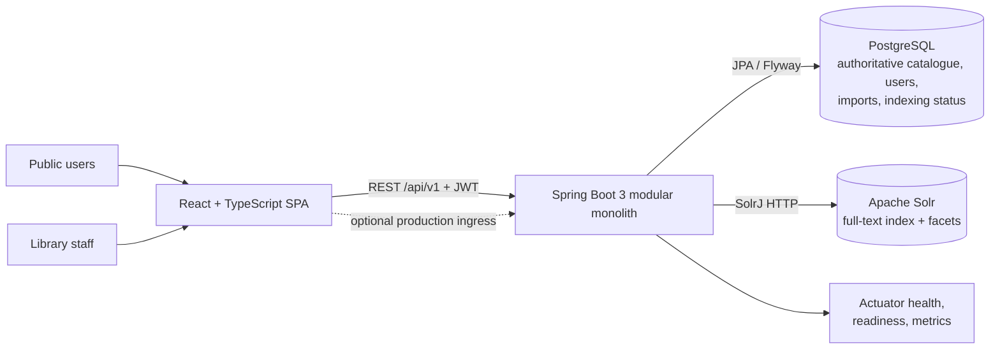

# OpenShelf — Digital Library Discovery & Operations Platform

OpenShelf is a digital library platform for universities, academic institutions, and public libraries. It combines a public discovery portal with a secure staff back office for catalogue management, Dublin Core XML imports, and search-index operations.

PostgreSQL is the authoritative datastore. Apache Solr provides relevance-ranked full-text search and facets, and every index failure is recorded in PostgreSQL and recoverable through reindexing.

> **Engineering ownership:** this repository contains the application only (React frontend + Spring Boot backend). Containerization, CI/CD, cloud provisioning, orchestration, and production operations are owned by DevOps and are intentionally not included.

## Contents

- [Features](#features)
- [Architecture](#architecture)
- [Technology stack](#technology-stack)
- [Repository layout](#repository-layout)
- [Prerequisites](#prerequisites)
- [Setup](#setup)
- [Configuration](#configuration)
- [Tests](#tests)
- [API documentation](#api-documentation)
- [Operational notes](#operational-notes)
- [Known limitations](#known-limitations)
- [Documentation](#documentation)
- [SecOps and security scanning](#secops-and-security-scanning)

## Features

### Public portal

- Landing page with real catalogue counts, recent additions, and most-viewed resources
- Catalogue browse with pagination
- Solr-backed search across title, authors, subjects, publisher, description, and identifiers
- Facets for resource type, language, and subject
- Filters, sorting (relevance, title, publication year), and pagination
- Resource detail pages with full metadata, subject tags, access links, and view counting
- Staff sign-in entry point

### Staff portal (JWT + server-side RBAC)

- `CATALOGUER` and `ADMIN` roles; user management is `ADMIN` only
- Dashboard with live PostgreSQL statistics and application health
- Catalogue create, edit, list, and archive (soft delete)
- Dublin Core XML import:
  - secure upload and parsing (DOCTYPE/XXE disabled, size limited)
  - preview with per-record validation errors
  - duplicate detection inside the upload and against existing catalogue identifiers
  - commit of valid records only
  - import history, job detail, and persisted errors
  - idempotent re-commit of completed jobs
- Indexing status (indexed/pending/failed), error visibility, and full reindex from PostgreSQL
- BCrypt password hashing, JSON `401`/`403` responses, env-driven CORS

## Architecture



Write path: a catalogue change is committed to PostgreSQL first, then indexed into Solr best-effort. The outcome (`INDEXED`/`FAILED` plus the error) is stored in `indexing_status`; a Solr outage never rolls back catalogue data.

Search path: discovery queries go to Solr for relevance and facets. Resource details are read from PostgreSQL by ID. If Solr is unavailable the search endpoint fails explicitly rather than silently returning fabricated data.

Import path: upload → secure parse → per-record validation → duplicate detection → preview job persisted in PostgreSQL → commit valid rows → best-effort indexing → history and errors retained.

### Backend modules

`auth`, `catalogue`, `author`, `subject`, `search`, `metadata`, `imports`, `indexing`, `admin`, `common`, `config`

### Key database tables

`users`, `resources`, `authors`, `subjects`, `resource_authors`, `resource_subjects`, `import_jobs`, `import_errors`, `indexing_status`, plus `flyway_schema_history`.

## Technology stack

| Layer | Technology |
| --- | --- |
| Frontend | React 19, TypeScript, Vite, Tailwind CSS, React Router, TanStack Query, React Hook Form, Zod, Lucide React |
| Backend | Java 21, Spring Boot 3.5, Maven, Spring Web, Spring Data JPA, Spring Security, Bean Validation |
| Data | PostgreSQL 16 + Flyway |
| Search | Apache Solr 9.7 + SolrJ |
| Auth | JWT (HMAC), BCrypt, server-side role checks |
| API docs | Springdoc OpenAPI / Swagger UI |
| Observability | Spring Boot Actuator, Micrometer, Prometheus registry |
| Tests | JUnit 5, Mockito, AssertJ, Testcontainers, Vitest, React Testing Library, Playwright |

## Repository layout

```text
backend/                 Spring Boot application and tests
  src/main/java/com/openshelf/
  src/main/resources/db/migration/
  src/test/java/
frontend/                React/Vite application, unit tests, Playwright config
  src/
  e2e/
solr/openshelf/conf/     Solr configset (schema, solrconfig, stopwords)
samples/xml/             Valid and mixed Dublin Core sample imports
docs/                    API, architecture, configuration, troubleshooting
.env.example             Backend/frontend configuration placeholders
```

## Prerequisites

- Java 21 and Maven 3.9+
- Node.js 20+ and npm
- PostgreSQL 15+ (validated on 16.15)
- Apache Solr 9.7+

## Setup

### 1. PostgreSQL

```bash
createuser --pwprompt openshelf
createdb --owner=openshelf openshelf
```

Flyway creates and seeds the schema on backend startup (20 authors, 15 subjects, 30 resources).

### 2. Solr

```bash
SOLR_HOME=/opt/solr
$SOLR_HOME/bin/solr start -p 8983
$SOLR_HOME/bin/solr create -c openshelf -d "$PWD/solr/openshelf"
curl http://localhost:8983/solr/openshelf/admin/ping
```

For a SolrCloud deployment, upload the same configset and create a collection named `openshelf` (or set `SOLR_COLLECTION`).

### 3. Backend

```bash
cd backend
export DB_HOST=localhost DB_PORT=5432 DB_NAME=openshelf DB_USER=openshelf DB_PASSWORD='...'
export SOLR_BASE_URL=http://localhost:8983/solr SOLR_COLLECTION=openshelf
export JWT_SECRET='replace-with-at-least-32-random-bytes'
export BOOTSTRAP_ADMIN_ENABLED=true
export BOOTSTRAP_ADMIN_EMAIL=admin@example.edu
export BOOTSTRAP_ADMIN_PASSWORD='choose-a-strong-password'
mvn spring-boot:run
```

The API listens on `http://localhost:8080`. Startup runs Flyway migrations and, if enabled, provisions the bootstrap admin. Disable `BOOTSTRAP_ADMIN_ENABLED` after initial provisioning.

Index the seeded catalogue: sign in to the staff portal and use **Indexing → Reindex all**, or call:

```bash
curl -X POST http://localhost:8080/api/v1/admin/indexing/reindex \
  -H "Authorization: Bearer $TOKEN"
```

### 4. Frontend

```bash
cd frontend
npm install
VITE_API_BASE_URL=http://localhost:8080/api/v1 npm run dev
```

Open `http://localhost:5173`. Public discovery needs no sign-in; staff pages require an account.

## Configuration

All values are environment-driven. See [docs/CONFIGURATION.md](docs/CONFIGURATION.md) for the full reference and [.env.example](.env.example) for placeholders.

Essential production settings:

| Variable | Purpose |
| --- | --- |
| `DB_HOST`, `DB_PORT`, `DB_NAME`, `DB_USER`, `DB_PASSWORD` | PostgreSQL connection |
| `SOLR_BASE_URL`, `SOLR_COLLECTION` | Solr endpoint and core/collection |
| `JWT_SECRET`, `JWT_EXPIRATION_MS` | Token signing and lifetime |
| `CORS_ALLOWED_ORIGINS` | Browser origins allowed to call the API |
| `MAX_UPLOAD_SIZE_MB` | XML upload limit |
| `BOOTSTRAP_ADMIN_*` | Optional initial admin; disabled by default |
| `VITE_API_BASE_URL` | Frontend API base (includes `/api/v1`) |

No secrets are committed. `.env.example` contains placeholders only.

## Tests

### Backend

```bash
cd backend
mvn test
```

Covers secure Dublin Core parsing (including XXE/DOCTYPE rejection), catalogue creation/conflicts/public visibility/view counting, indexing-failure isolation and actionable outage errors, authentication (success, bad credentials, inactive users), user-management safety (last-admin protection, duplicate email), and Solr query construction (escaping, safe title sort, and Solr outage mapped to `503`). `PostgresIntegrationTest` additionally validates Flyway migrations and seed data against a real PostgreSQL container when Docker is available.

### Frontend unit/component tests

```bash
cd frontend
npm run test
```

Covers login rendering, protected routing and role guard, search empty state, resource detail metadata, resource form validation/submission, and import preview/commit UI.

### Frontend end-to-end smoke tests

```bash
cd frontend
npx playwright install chromium   # first run only
npm run test:e2e
```

Specs live in `frontend/e2e/`. They expect the frontend at `http://127.0.0.1:5173` by default; the Playwright config starts it automatically unless `E2E_BASE_URL` is set. Search and staff flows need the backend (and Solr for search) running.

### Verification status

- `mvn test` — executed successfully: 7 test classes, 18 tests passed, 0 failures; 1 Docker-gated PostgreSQL/Testcontainers test skipped because Docker is unavailable.
- `npm run build` — executed successfully (TypeScript project build + Vite production build).
- `npm run test` — executed successfully: 6 test files, 9 tests.
- `npm run test:e2e` — executed successfully: 3 Playwright smoke tests passed against the running backend and Solr.
- Live manual verification — backend was started against a real PostgreSQL 16.15 instance and a real Apache Solr 9.7.0 core. Verified: Flyway migrations, login/JWT, RBAC (`401`/`403`), catalogue create/update/archive, duplicate-identifier `409`, validation `400`, XML preview/duplicate detection/commit/idempotent re-commit, last-admin protection, actuator probes, Swagger, and OpenAPI. Search relevance, facets, subject filters, title/date sorting, and pagination were verified against Solr. A Solr outage was simulated: catalogue writes still committed, indexing failures were recorded with an actionable message, search returned `503 SERVICE_UNAVAILABLE`, and reindexing after restart recovered both the index and the failed records.

## API documentation

While the backend is running:

- Swagger UI: `http://localhost:8080/swagger-ui.html`
- OpenAPI JSON: `http://localhost:8080/v3/api-docs`
- Full endpoint reference: [docs/API.md](docs/API.md)

All application responses use `{ success, data, message, timestamp }`; errors use a flat `{ timestamp, status, error, code, message, path, violations }` body.

## Operational notes

- Health: `/actuator/health`
- Liveness: `/actuator/health/liveness`
- Readiness: `/actuator/health/readiness`
- Metrics: `/actuator/metrics`, Prometheus scrape: `/actuator/prometheus`
- Admin health summary: `GET /api/v1/admin/system/health`
- Failed Solr writes are recorded in `indexing_status.last_error` and surfaced in the staff indexing page.
- Reindexing is the recovery procedure after a Solr outage or schema change.
- See [docs/TROUBLESHOOTING.md](docs/TROUBLESHOOTING.md) for common failures.

## Known limitations

- **Bootstrap assumption:** this repository has no deployment topology. DevOps must provide PostgreSQL, Solr, TLS, secret management, backups, and process supervision.
- **Single Solr core:** the schema and client target one collection; SolrCloud and shard/replica tuning are deployment concerns.
- **Synchronous work:** XML import, indexing, and reindex run synchronously in the API process. Very large uploads or full reindexes can take time; move them to a background worker before scaling.
- **In-memory uploads:** files are parsed from the request stream with a configurable size cap; multipart files are not streamed to disk.
- **Duplicate detection:** exact, case-insensitive identifier matching. It does not normalize DOIs/ISBNs or perform fuzzy title matching.
- **Public statistics:** “popular” is based on `view_count` increments on detail views; it is not a separate analytics system.
- **Auth model:** stateless JWT with no refresh-token rotation or server-side revocation list. Rotating `JWT_SECRET` invalidates all tokens.
- **No audit log:** catalogue and user changes are not written to a separate audit trail.
- **Testcontainers:** `PostgresIntegrationTest` runs the full Spring context against a real PostgreSQL container when Docker is available. It auto-skips when Docker is unavailable, which was the case in this build environment; the remaining unit/service tests run without Docker.
- **Playwright browsers:** the E2E suite was executed with Chromium headless shell. On minimal Linux images the browser needs `libnspr4`/`libnss3`; install them or run `npx playwright install-deps chromium` on a machine with package-install rights.

## Documentation

- [docs/ARCHITECTURE.md](docs/ARCHITECTURE.md) — design decisions and flows
- [docs/API.md](docs/API.md) — endpoints, payloads, roles
- [docs/CONFIGURATION.md](docs/CONFIGURATION.md) — environment reference and external-service setup
- [docs/TROUBLESHOOTING.md](docs/TROUBLESHOOTING.md) — common failures and recovery
- [solr/README.md](solr/README.md) — Solr configset notes
- [samples/xml](samples/xml) — sample Dublin Core imports (valid and mixed)

## SecOps and security scanning

The `OpenShelf SecOps` GitHub Actions workflow runs the following scans on every push to `main`, every pull request to `main`, a weekly schedule, and manual runs:

| Scan | Tool | Gate |
| --- | --- | --- |
| Secret scanning | [Gitleaks](https://github.com/gitleaks/gitleaks) | Fails the **Secret Scanning** job on any finding |
| Dependency vulnerability review | [Dependency Review](https://github.com/actions/dependency-review-action) | Fails the **Dependency Review** job on HIGH findings (PRs only) |
| CodeQL (Java/Kotlin, JavaScript/TypeScript) | [CodeQL](https://codeql.github.com/) | Fails the **CodeQL** jobs on findings |
| Filesystem, secrets, dependency and IaC scanning | [Trivy](https://github.com/aquasecurity/trivy) v0.76.2 | Fails the **Trivy Filesystem and IaC Scan** job on HIGH/CRITICAL findings |
| Backend/frontend build and tests | Maven / Vitest | Fails **Backend Build and Tests** / **Frontend Build and Tests** |
| Container builds and scans | Docker + Trivy | Fails the **Container Security and SBOM** job on HIGH/CRITICAL image findings, or a failed scan |
| SBOMs | CycloneDX | Uploaded to GitHub Security as dependency snapshots (`sbom/backend.cdx.json`, `sbom/frontend.cdx.json`) |

- **Vulnerability gates are not disabled:** the Trivy and CodeQL jobs fail on genuine HIGH/CRITICAL findings.
- **Accepted findings** (see [SECURITY-EXCEPTIONS.md](SECURITY-EXCEPTIONS.md)):
  - `AWS-0104` — the demo EC2 node requires unrestricted public outbound egress (registries, DNS, apt).
  - `CVE-2026-47884`, `CVE-2026-47890` — `org.springframework:spring-webmvc` (Spring Framework 6.2.19) in the backend pom and image builds; fixed in SF 7.0.9, which requires Spring Boot 4, so the app stays on Boot 3.5.16.
  - Historical `generic-api-key` on `docs/API.md` — the example JWT in the docs; the value is now the placeholder `"<JWT>"` and the finding is recorded in `.gitleaksignore`.
  - License findings on the Spring Boot stack (`LGPL-2.1-only`, `LGPL-2.1-or-later`, `GPL-2.0-with-classpath-exception`) — accepted in the Trivy filesystem job via `--ignored-licenses`.
- **Dependabot** updates run weekly (`.github/dependabot.yml`); every dependency PR runs the full SecOps checks.

## License

TBD.
